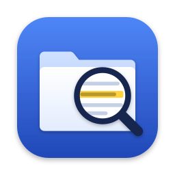

<p align="center"></p>

# Folder Search

Pick a folder, let it index, then search the documents in it by meaning, not just by exact words. Ask "when did the limitation period start to run" and you get the passages that discuss it, including ones that never use those words, each with its page number and a preview of the page with the passage highlighted.

Everything runs on your Mac. Your documents are never uploaded anywhere.

## Install

macOS only (Apple Silicon recommended). Paste this into Terminal:

```sh
curl -LsSf https://raw.githubusercontent.com/chapmanwilliam/folder-search/main/install.sh | sh
```

Then open **Folder Search** from the Applications folder in your home folder, or from Spotlight. Run the same command again to update.

The first time you open it, Folder Search downloads its language model (about 1.2 GB, once).

**Optional:** to make scanned PDFs (images of pages, with no text layer) searchable, install OCR with [Homebrew](https://brew.sh): `brew install ocrmypdf`. Without it, scanned PDFs are listed as "not readable" instead.

## Using it

1. **Add folder…** and choose a folder. Folder Search counts the documents first and tells you how long indexing will take.
2. If some files exist only in the cloud (Dropbox "online-only", iCloud "Optimise Mac Storage", OneDrive, Google Drive), it tells you how many there are and how much they would take to download. You choose whether to index only the files already on your Mac, or to download everything.
3. Indexing runs in the background, so you can search while it works. You can stop at any time; next time it carries on where it left off.
4. Type what you are looking for in plain English. Put words in "double quotes" to require that exact phrase. If the folder has subfolders (one per case or client, say), you can limit the search to one of them.
5. Click a passage to see the page. **Open** opens the file; **Show in Finder** shows where it is.

### Keeping up to date

While the app is open, it keeps your folders up to date by itself:

- **When it opens**, it checks every folder and indexes anything added, changed or deleted while it was closed. If a first index was interrupted, it carries on.
- **While it is open**, macOS tells it when files in an indexed folder change. About a minute after the changes stop (so a document being saved, or a batch being copied in, is handled once), it indexes just what changed.

These updates run quietly: a line at the bottom of the sidebar shows what is happening. They never download cloud-only files unless you chose that for the folder. If you press **Stop** while a folder is indexing, that folder is paused and left alone until you choose **Resume indexing** from its ⋯ menu. You can also choose **Update index** from that menu at any time.

If a folder goes missing or suddenly looks empty (a drive not connected, or Dropbox not running), its index is kept, not wiped.

Reads: PDF, Word (.docx and .doc), RTF, plain text, Markdown, and email (.eml and Outlook .msg).

## Privacy

- Documents are read and indexed on your Mac. Nothing is sent anywhere.
- The only network access is the one-time model download from Hugging Face. Once the model is on your Mac, the app runs fully offline.
- Folder Search never changes, moves or deletes anything in the folders you index. Its index lives in `~/Library/Application Support/Folder Search/`. Removing a folder from Folder Search deletes that index and nothing else.
- With "index only files on this Mac" chosen, the app tells macOS to refuse cloud downloads for the whole run, so a cloud-only file cannot be downloaded by mistake.

## How it works

- **Text extraction:** PyMuPDF for PDFs (page by page, so results carry page numbers), python-docx, macOS `textutil` for .doc and RTF, and the standard library for email. ocrmypdf handles scans, if installed.
- **Passages:** text is split into passages of about 400 tokens that overlap a little, and never lose track of their page.
- **Meaning:** each passage is turned into a vector by Google's [EmbeddingGemma 2](https://huggingface.co/google/embeddinggemma-2) (Apache 2.0), running on the Mac's GPU.
- **Search:** combines vector similarity (sqlite-vec, int8 vectors) with keyword search (SQLite FTS5 with stemming), fused by reciprocal rank. Meaning-based search finds paraphrases; keyword search keeps exact names, references and dates reliable.

**Speed on an M-series Mac:** about 30 passages a second to index, which is roughly one typical document a second. Searching a folder of 800,000 passages takes about half a second.

## Command line

The same engine is available as `fsearch`:

```sh
fsearch scan ~/Documents/Cases          # count documents on disk and cloud-only
fsearch index ~/Documents/Cases         # index (incremental); --include-online to download cloud files
fsearch search "date of knowledge" -n 5 # search every indexed folder
fsearch list                            # indexed folders and their stats
fsearch failures ~/Documents/Cases      # files that could not be read, and why
fsearch remove ~/Documents/Cases        # forget a folder and delete its index
```

## Development

```sh
git clone https://github.com/chapmanwilliam/folder-search && cd folder-search
uv sync
uv run pytest -m "not model"   # fast tests; drop the -m to include the real-model test
uv run folder-search           # the app
uv run python scripts/dev_server.py   # the UI in a normal browser, for front-end work
```

The engine is in `src/folder_search/engine/` and has no UI code. The desktop window is [pywebview](https://pywebview.flowrl.com/) over plain HTML, CSS and JavaScript in `src/folder_search/ui/`, with no build step.

## Licence

Apache 2.0. See [LICENSE](LICENSE).
